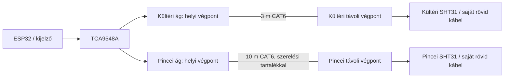

# HESTORE alkatrész-összeállítás – 2026-10-16

**A böngészőben 24 tételes kosár készült. Bruttó 135 684 Ft, szállítás nélkül. Rendelés/fizetés nem történt.** A kosár a megnyitott böngésző munkamenetéhez kötődik; a sima kosárhivatkozás másik böngészőben nem viszi át a tartalmat. Az árak és készletjelzések az ellenőrzés idején érvényesek. A HESTORE egész forintos megjelenítése miatt a kerekített egységárakból számolt összeg 1 Ft-tal eltérhet a kijelzett sorösszegtől.

Ez előzetes beszerzési kosár, **nem teljes, jóváhagyott telepítési készlet és nem kész kapcsolási terv**. A hálózati védelmek, kábelhosszak, csatlakozók, nyák- és dobozrögzítések véglegesítése még hátra van. A jelenlegi kosár elemei a katalógusban megtalálhatók; a két SHT31, a négy QwiicBus végpont és a 10 m-es adatkábel 3 munkanapos beszerzési jelzést kapott. A háztartási páramentesítőt és a már megadott ventilátort nem tettem újra a kosárba.

## Kapott készülékadatok

- Ventilátor: Vents 100 VKO L TURBO; a [megadott Dalap termékoldal](https://www.dalap.hu/kismeretu-golyos-csapagyazasu-csoventilator-emelt-teljesitmennyel-szukitett-o-100-mm-x11792) 230 V, 16 W, 0,1 A és 135 m³/h névleges légszállítást ad meg. A tényleges csőhálózati légszállítás ettől eltérhet.
- Páramentesítő: felhasználó által megadott adattábla: 350 W / 1,7 A névleges, legfeljebb 420 W / 2,1 A, 195 m³/h belső légkeringetés, 5–32 °C üzemi tartomány. A pontos modell és kompresszorindítási/LRA adat nincs meg. A 195 m³/h nem kültéri légcsere. Ezek nem helyettesítik a fogyasztás- és vízkivonásmérést.
- A baseline szimuláció korábbi 300 W-os feltételezését nem írtam át és nem kevertem a korábbi 950 futás eredményébe. Az új névleges adatok külön hardveradatok.
- A [gyártói Iskra termékoldal](https://b2bshop.iskra.eu/en_US/products/ikd20-20-24v40-500hz-030046024000-en) az IKD20-20/24V jelöltet azonosítja; a [gyártói tanúsítvány](https://www.iskra.eu/f/docs/Iskra-Installation-Contactors/NL-101961_DEKRA_statement_ID_132138_eng3.pdf) 9 A motoros AC-3 terhelhetőséget igazol a NO változatra. Ez alapján ésszerű jelölt a 2,1 A-es készülékhez, de nem önmagában a 20 A felirat miatt. A kompresszorindítás és a teljes környezet ellenőrzése megmarad.

## A tényleges kosár

| Tétel | Mennyiség | Nettó egységár | Nettó sorösszeg | Szerep / feltétel |
|---|---:|---:|---:|---|
| [ESP32-3248S035C-CYD](https://www.hestore.hu/prod_10050365.html) (100.503.65) | 1 | 9 903 Ft | 9 903 Ft | Kijelzős ESP32 vezérlő; a pontos board revision és GPIO-k ellenőrizendők. |
| [DF-SEN0385](https://www.hestore.hu/prod_10052470.html) (100.524.70) | 2 | 7 902 Ft | 15 804 Ft | 1 pince + 1 kültér. Két védett SHT31; 3 munkanapos beszerzési jelzés. Az olcsó SHT30-M kereskedői leírása csak 0–90% RH-t adott meg, ezért a 100%-ig vizsgált pince végleges listájába nem ezt választottam. |
| [TCA9548A-M](https://www.hestore.hu/prod_10047629.html) (100.476.29) | 1 | 567 Ft | 567 Ft | A két azonos I2C-című érzékelő külön csatornára kerülhet. Nem hosszúkábel-meghajtó. |
| [KS 5V/2A/M](https://www.hestore.hu/prod_10038280.html) (100.382.80) | 1 | 2 014 Ft | 2 014 Ft | 5 V / 2 A, microUSB: a vezérlő külön tápja. Nem a kontaktorok 24 V-os táplálása. |
| [IKD20-20/24V](https://www.hestore.hu/prod_10040139.html) (100.401.39) | 2 | 5 475 Ft | 10 950 Ft | 1 ventilátorhoz + 1 páramentesítőhöz, előzetes motoros kapcsolójelölt. 24 V AC/DC tekercs; NO érintkező AC-3/AC-7b: 9 A. A kész beépítéshez indítási áram és védelmi koordináció még ellenőrizendő. |
| [SSR-2CH-3-24V-HIGH](https://www.hestore.hu/prod_10048147.html) (100.481.47) | 1 | 1 849 Ft | 1 849 Ft | Két 24 V DC kontaktortekercs kisfeszültségű vezérlésének jelöltje. 3–24 V bemenet, legfeljebb 50 V DC / 2 A kimenet. NEM 230 V-os SSR, a készülékeket közvetlenül nem kapcsolhatja. Meghajtóáram, indulási állapot és tekercstranziens ellenőrzendő. |
| [HDR-15-24](https://www.hestore.hu/prod_10040961.html) (100.409.61) | 1 | 4 772 Ft | 4 772 Ft | 24 V, 0,63 A, 15,2 W tekercstáp jelölt. A két konkrét tekercs behúzási és tartási áramával véglegesítendő; a 230 V-os része a hálózati szekrénybe tartozik. |
| [JT-A1250H-4P-300](https://www.hestore.hu/prod_10047751.html) (100.477.51) | 1 | 241 Ft | 241 Ft | A kijelzős panelhez a kereskedő által ajánlott 4 pólusú, 1,25 mm-es kábel. Lábkiosztás/polaritás a konkrét panel alapján. |
| [RC-40-20/FF](https://www.hestore.hu/prod_10035719.html) (100.357.19) | 1 | 866 Ft | 866 Ft | Próbapadi összekötés, kizárólag kisfeszültségű oldalra. Nem végleges pincekábel és nem hálózati vezeték. |
| [GOOBAY-72227](https://www.hestore.hu/prod_10051073.html) (100.510.73) | 1 | 827 Ft | 827 Ft | MicroUSB adatkábel a programozáshoz. |
| [PZEM-004T-PZCT-WE](https://www.hestore.hu/prod_10050433.html) (100.504.33) | 1 | 6 542 Ft | 6 542 Ft | Dobozolt, nyitható áramváltós PZEM-004T működés-/teljesítmény-visszajelzéshez. TTL UART Modbus RTU, 9600 8N1; 5 V-os logikai oldal. A hálózat felől is táplálni kell; pusztán 5 V-ról nem kommunikál. A kereskedő 100 A-es CT és 23 kW mellett egy helyen 0–10 A tartományt is ír: a pontos változat és adatlap átvételkor ellenőrizendő. |
| [TXS0108E-M](https://www.hestore.hu/prod_10047917.html) (100.479.17) | 1 | 336 Ft | 336 Ft | UART 3,3/5 V jelszintillesztő-jelölt. VCCA/VCCB, OE és felhúzások a konkrét PZEM/panelhez tervezendők. Nem 230 V-os leválasztó. |
| [CJMCU-2317](https://www.hestore.hu/prod_10048961.html) (100.489.61) | 1 | 1 241 Ft | 1 241 Ft | OPCIONÁLIS MCP23017 GPIO-bővítő a szűkös panelkivezetésekhez. Nem UART-bővítő és nem I2C-címmultiplexer. Ha két megfelelő vezérlő-GPIO marad szabadon, elhagyható. |
| [STI1700](https://www.hestore.hu/prod_10048464.html) (100.484.64) | 1 | 9 022 Ft | 9 022 Ft | Hálózati szekrény alap, külön az érinthető kijelzőelektronikától; a belső elrendezés, PE-kötés és rögzítés még tervezendő. |
| [STI1503](https://www.hestore.hu/prod_10044641.html) (100.446.41) | 3 | 1 442 Ft | 4 327 Ft | 3 doboz: 1 a kijelzőhöz, 1 a kültéri buszvégpontnak, 1 a pincei buszvégpontnak. Kivágás/átvezetés után a kész szerelvény védettsége külön ellenőrizendő. |
| [DIN-TS35-60](https://www.hestore.hu/prod_10051529.html) (100.515.29) | 2 | 1 442 Ft | 2 885 Ft | 2 × 60 mm DIN-sín szerelési alapanyag. A teljes védelmi készülékkiosztáshoz további sín kellhet. |
| [PG9-WH](https://www.hestore.hu/prod_10042108.html) (100.421.08) | 5 | 144 Ft | 721 Ft | 5–8 mm külső kábelátmérőhöz. 5 darab összesen olcsóbb volt, mint 4 a mennyiségi lépcső miatt. A valós kábelek átmérőjével ellenőrizendő. |
| [WAGO 221-413](https://www.hestore.hu/prod_10036983.html) (100.369.83) | 10 | 158 Ft | 1 577 Ft | 10 darab 3 vezetékes összekötő. Egy darabban a három csatlakozás közös potenciálú; nem három külön áramkör. A szükséges kötés-/PE-kialakítás még tervezendő. |
| [PG7-WH](https://www.hestore.hu/prod_10042101.html) (100.421.01) | 2 | 180 Ft | 360 Ft | 3,5–6 mm külső kábelátmérőhöz, 2 darab. A szenzor tényleges kábelátmérőjével összevetendő. |
| [ALFA AV-2+F](https://www.hestore.hu/prod_10044534.html) (100.445.34) | 1 | 2 270 Ft | 2 270 Ft | Kapcsolt, földelt, fedeles 16 A / 250 V dugalj jelölt a páramentesítőnek. A kész rendszer érintésvédelmi ellenőrzést igényel. |
| [DPCB-812](https://www.hestore.hu/prod_10048010.html) (100.480.10) | 1 | 956 Ft | 956 Ft | 8×12 cm univerzális szerelőnyák, csak a kisfeszültségű elektronikához. Nem hálózati kapcsolópanel. |
| [COM-16988](https://www.hestore.hu/prod_10051070.html) (100.510.70) | 4 | 6 106 Ft | 24 423 Ft | 4 végpont = két külön pont–pont differenciális I2C kapcsolat; érzékelőnként 1 helyi + 1 távoli modul. 3 munkanapos beszerzés. Nem Ethernet és nem galvanikus leválasztó. |
| [DK-1644-030](https://www.hestore.hu/prod_10046470.html) (100.464.70) | 1 | 1 302 Ft | 1 302 Ft | 1 × 3 m rézeres CAT6 kábel a kültéri differenciális szakaszhoz; az érzékelő saját 1 m-es vezetéke a távoli végpontnál marad. |
| [DK-1644-100](https://www.hestore.hu/prod_10046472.html) (100.464.72) | 1 | 3 084 Ft | 3 084 Ft | 1 × 10 m rézeres CAT6 kábel a pincei 5–6 m-es távolsághoz, nyomvonal- és szerelési tartalékkal; a szükséges kész hosszt telepítéskor ellenőrizni kell. 3 munkanapos beszerzés. |

## Ami nincs véglegesítve vagy nincs a kosárban

| Elem | Állapot és ok |
|---|---|
| Pontosan ehhez a 3,5 colos panelhez illő kész kijelzőkeret, tömítés, érinthető előlap | Nem találtam a panelhez igazolt kész megoldást. A kosárban általános doboz van; egyedi mechanikai munka/keret és szerelési távtartók szükségesek. A csavar-/távtartóméret CAD és a pontos board után választható. |
| Érzékelőnyomvonal és távoli tápellátás | A megadott távolságokhoz négy differenciális végpont és 3 m + 10 m adatkábel bekerült. A végleges nyomvonal, távoli feszültségesés, jumper-/tápbeállítás és felhúzók ellenőrzése még szükséges; lásd a lenti távolságkiegészítést. |
| Vezérlő GPIO / UART és csatlakozólábkiosztás | A pontos CYD board revision és szabad kivezetések még nincsenek igazolva. A PZEM UART-hoz két használható GPIO vagy valódi UART-bővítő kell; az MCP23017 ezt nem pótolja. A kosár együttműködési terv, nem igazolt pin-kompatibilitás. |
| Kisfeszültségű kimenetek indulási védelme, OE/lehúzók, tekercstranziens-védelem | A végleges kapcsolás alapján kell meghatározni az alkatrészeket és mennyiségeket. Az SSR modul 3 V alsó bemeneti határa önmagában nem igazolja az ESP32/MCP kimenetének elegendő meghajtóáramát. |
| 230 V-os betáp-/ventilátor-/dugaljkábel, erek és keresztmetszet, érvéghüvelyek, PE/N sín, sorkapocsrögzítés | Telepítési hossz, vezetési mód és helyszíni érintésvédelem alapján méretezendők. A jumpervezetékek nem használhatók helyettük. Ezek hiánya nem azt jelenti, hogy nem kaphatók a HESTORE-ban. |
| Biztosíték/kismegszakító, áram-védőkapcsoló, leválasztás és védelmi koordináció | A meglévő pinceáramkör ismerete nélkül nem választottam B/C jelleggörbét, áramerősséget vagy RCD-t. NEEDS ELECTRICAL DESIGN / VERIFICATION, az eredeti specifikációnak megfelelően. A hálózati részt villamos szakembernek kell véglegesítenie és ellenőriznie. |
| Szellőzőcső, rács, visszacsapó és eső/nap elleni érzékelő-elhelyezés | A helyszíni légtechnikai kialakítás függvénye. A megadott ventilátor Dalap termék; nem választottam helyette számítógépventilátort. |
| Valós auto restart és teljesítmény-visszajelzés | A készülék áramszünet utáni viselkedése még kipróbálandó. A PZEM hardverjelölt, a hozzá tartozó ESP32 monitoradapter még fejlesztendő. A szimulátor nem írható fel hardverigazolásként. |

A hálózati és kisfeszültségű oldalt fizikailag külön kell tartani. A 24 V-os SSR-kimenet kizárólag a tekercskört kapcsoló jelölt; **nem kerülhet közvetlenül a 230 V-os készülék elé**. Konkrét hálózati bekötési rajzot ez a lista nem ad.

A böngésző a hivatalos fájlexportot egy külső követési kérés miatti tiltással megakasztotta; ezt nem kerültem meg. A helyi JSON és ez a táblázat a látható kosártartalomból készült saját feljegyzés, nem a bolt hivatalos exportfájlja. A kosarat a megnyitott böngészőben hagytam.

## Távolságok alapján módosított beszerzés

A felhasználó adatai: kültéri érzékelő 2–3 m, pincei érzékelő 5–6 m, páramentesítő 6–7 m, ventilátor 3–4 m a vezérlőtől. Ezek elhelyezési távolságok, nem lemért kábelnyomvonalak.

A rövid helyi I2C busz két TCA9548A-csatornájáról egy-egy külön QwiicBus-pár indul. A két ágat nem kötjük össze egy passzív RJ45 elosztóval. Így az azonos című érzékelők is elkülönülnek.

A [SparkFun gyártói útmutató](https://learn.sparkfun.com/tutorials/sparkfun-qwiicbus-hookup-guide/all) alapján a végpontok differenciális I2C-t továbbítanak RJ45 kábelen; a sebesség, táp és lezárás számít. Kezdő tervezési órajel 100 kHz, majd helyszíni ellenőrzés a tényleges kábelekkel és kapcsoló készülékek mellett. Ez még nem igazolt hardverüzem.

A távoli 5 V-os tápellátás jelölt a kábelfeszültség-esés csökkentésére, de a helyi ESP32-oldal 3,3 V-os marad. A végpontok jumpereit ehhez a gyártói leírás szerint külön kell beállítani; az alapbeállítás nem tekinthető automatikusan megfelelőnek. A távoli SHT31 kapocsfeszültsége a saját megadott tartományában maradjon. A CAT6 itt nem számítógépes hálózat és nem szabványos PoE; switch/router csatlakozásra nem való.

A távoli végpontokhoz két további doboz került a kosárba. Az előre szerelt RJ45 dugókhoz megfelelő tömített átvezetés vagy szakszerű újrakrimpelés kell: a már kiválasztott PG7/PG9 nem automatikusan alkalmas a kész dugó átfűzésére és tömítésére. Ez a mechanikai rész még tervezendő.

**Központi kapcsolódobozos elhelyezési javaslat:** a kontaktorok, a tekercsmeghajtó és a PZEM a vezérlő közelében, külön hálózati térben maradnak. A páramentesítő 6–7 m-es és a ventilátor 3–4 m-es távolságát megfelelően méretezett készülék-tápvezeték hidalja át. A PZEM TTL UART-ját nem visszük ki 6–7 m-re. Ha a kapcsolódobozt mégis a készülékhez tennénk, a vezérlőjel és visszajelzés átvitelét újra kellene tervezni.

A 230 V-os kábelek nyomvonala, keresztmetszete, pontos hossza, védelem és PE-kialakítás továbbra is a végleges villamos terv része. A távolságok ismerete önmagában nem határozza meg ezeket.

A módosítás előtt 95 432 Ft volt a kosár, most **135 684 Ft bruttó**, azaz **40 252 Ft-tal több**, szállítás nélkül. Új tételek: 4 végpont, 1×3 m és 1×10 m rézeres adatkábel; a STI1503 doboz mennyisége 1-ről 3-ra nőtt. Minden hozzáadott főelem megtalálható a HESTORE-ban. Rendelés/fizetés nem történt.
